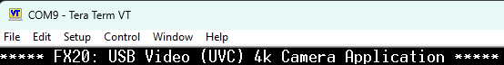

# EZ-USB&trade; FX20: USB Video Class (UVC) 4K camera application

This code example demonstrates the implementation of a USB Video Class (UVC) 1.1 compliant camera application using the EZ-USB&trade; FX20 device. An integrated USB Audio Class (UAC) interface is provided to stream the audio data received from a pulse density modulation (PDM) microphone.
This example illustrates the configuration and usage of GPIF III on the EZ-USB&trade; FX20 device to implement the Synchronous Slave FIFO IN protocol on LVCMOS mode interface and LVDS receiver implementation in LVDS mode.

> **Note:** This code example is applicable for EZ-USB&trade; FX20, EZ-USB&trade; FX10, EZ-USB&trade; FX5N, and EZ-USB&trade; FX5 devices.

[View this README on GitHub.](https://github.com/Infineon/mtb-example-fx20-uvc-uac-4k-camera)

[Provide feedback on this code example.](https://yourvoice.infineon.com/jfe/form/SV_1NTns53sK2yiljn?Q_EED=eyJVbmlxdWUgRG9jIElkIjoiQ0UyNDE3MTAiLCJTcGVjIE51bWJlciI6IjAwMi00MTcxMCIsIkRvYyBUaXRsZSI6IkVaLVVTQiZ0cmFkZTsgRlgyMDogVVNCIFZpZGVvIENsYXNzIChVVkMpIDRLIGNhbWVyYSBhcHBsaWNhdGlvbiIsInJpZCI6InN1bWl0Lmt1bWFyQGluZmluZW9uLmNvbSIsIkRvYyB2ZXJzaW9uIjoiMS4wLjEiLCJEb2MgTGFuZ3VhZ2UiOiJFbmdsaXNoIiwiRG9jIERpdmlzaW9uIjoiTUNEIiwiRG9jIEJVIjoiV0lSRUQiLCJEb2MgRmFtaWx5IjoiU1NfVVNCIn0=)


## Requirements

- [ModusToolbox&trade;](https://www.infineon.com/modustoolbox) v3.4 or later (tested with v3.4)
- Board support package (BSP) minimum required version: 4.3.3
- Programming language: C


## Supported toolchains (make variable 'TOOLCHAIN')

- GNU Arm&reg; Embedded Compiler v11.3.1 (`GCC_ARM`) – Default value of `TOOLCHAIN`
- Arm&reg; Compiler v6.22 (`ARM`)


## Supported kits (make variable 'TARGET')

- [EZ-USB&trade; FX20 DVK](https://www.infineon.com/fx20) (`KIT_FX20_FMC_001`) – Default value of `TARGET`


## Hardware setup

The hardware used to stream video and audio over the UVC and UAC interface are as follows:

- This example uses the EZ-USB&trade; FX20/FX10/FX5N/FX5 Development Kit (DVK)

- Ti180 J484 FPGA Development Kit from Efinix

- Sony IMX715 image sensor accessory board (DEMO_MIPI_4K_CAM01) or [VC MIPI IMX415C](https://www.mouser.in/ProductDetail/Vision-Components/VC-MIPI-IMX415C?qs=t7xnP681wgXy0NWbUYQoyQ%3D%3D) camera module

- PDM microphones [IM69D130](https://www.infineon.com/cms/en/product/sensor/mems-microphones/mems-microphones-for-consumer/im69d130)/[IM69D130 Microphone Shield2Go Evaluation Board](https://www.infineon.com/dgdl/Infineon-IM69D130_Microphone_Shield2Go-GS-v01_00-EN.pdf?fileId=5546d462677d0f4601677f3486ed0941)

- USB 3.2 Gen 2x2 cable (supplied with EZ-USB&trade; FX20 DVK)

See the "Hardware kit" section from the [AN238689 – Implementing a USB video and audio composite device using EZ-USB&trade; FX20/FX10/FX5N/FX5 controller](https://www.infineon.com/cms/en/product/universal-serial-bus/usb-3.2-peripheral-controllers/ez-usb-fx20-usb-20-gbps-peripheral-controller/#!?fileId=8ac78c8c96250806019641f096a570ca) to ensure that the board is configured correctly.

This example demonstrates the implementation of a UVC-compliant camera application with image sensor [VC MIPI IMX415C](https://www.mouser.in/ProductDetail/Vision-Components/VC-MIPI-IMX415C?qs=t7xnP681wgXy0NWbUYQoyQ%3D%3D) or [THine](https://www.thinesolutions.com/13mp-pdaf-camera-for-jetson-orin) along with [Titanium Ti180 J484 Development Kit](https://www.efinixinc.com/products-devkits-titaniumti180j484.html) as the video source.

> **Note:** Default colorbar from Titanium Ti180 J484 Development Kit is configured.

> **Note:** Titanium Ti180 J484 Development Kit is used for demonstration purpose only. The Ti180 FPGA project files and bit files listed in **Table 7** (see [FPGA BitFile information](#fpga-bitfile-information) section) supports up to 4K (3840 x 2160) colorbar video streaming.

> **Note:** The camera modules used in this code example code is for demonstration purpose only.


## Software setup

See the [ModusToolbox&trade; tools package installation guide](https://www.infineon.com/ModusToolboxInstallguide) for information about installing and configuring the tools package.

- Install a terminal emulator if you do not have one. Instructions in this document use [Tera Term](https://teratermproject.github.io/index-en.html)

- Install [EZ-USB&trade; FX Control Center](https://softwaretools.infineon.com/tools/com.ifx.tb.tool.ezusbfxcontrolcenter) for loading EZ-USB&trade; FX20 binaries to internal flash and FPGA bit files to external flash Solution Demo Kit (SDK).

> **Note:** Loading FPGA bit files to the Titanium Ti180 J484 Development Kit must be done through Efinity Programmer

- Install [Efinity Software](https://www.efinixinc.com/products-efinity.html) if you are using Ti180 DVK

- Install [Audacity](https://www.audacityteam.org/download/windows/) for recording the audio


## Using the code example


### Create the project

The ModusToolbox&trade; tools package provides the Project Creator as both a GUI tool and a command line tool.

<details><summary><b>Use Project Creator GUI</b></summary>

1. Open the Project Creator GUI tool

   There are several ways to do this, including launching it from the dashboard or from inside the Eclipse IDE. For more details, see the [Project Creator user guide](https://www.infineon.com/ModusToolboxProjectCreator) (locally available at *{ModusToolbox&trade; install directory}/tools_{version}/project-creator/docs/project-creator.pdf*)

2. On the **Choose Board Support Package (BSP)** page, select a kit supported by this code example. See [Supported kits](#supported-kits-make-variable-target)

   > **Note:** To use this code example for a kit not listed here, you may need to update the source files. If the kit does not have the required resources, the application may not work

3. On the **Select Application** page:

   a. Select the **Applications(s) Root Path** and the **Target IDE**

      > **Note:** Depending on how you open the Project Creator tool, these fields may be pre-selected for you

   b. Select this code example from the list by enabling its check box

      > **Note:** You can narrow the list of displayed examples by typing in the filter box

   c. (Optional) Change the suggested **New Application Name** and **New BSP Name**

   d. Click **Create** to complete the application creation process

</details>


<details><summary><b>Use Project Creator CLI</b></summary>

The 'project-creator-cli' tool can be used to create applications from a CLI terminal or from within batch files or shell scripts. This tool is available in the *{ModusToolbox&trade; install directory}/tools_{version}/project-creator/* directory.

Use a CLI terminal to invoke the 'project-creator-cli' tool. On Windows, use the command-line 'modus-shell' program provided in the ModusToolbox&trade; installation instead of a standard Windows command-line application. This shell provides access to all ModusToolbox&trade; tools. You can access it by typing "modus-shell" in the search box in the Windows menu. In Linux and macOS, you can use any terminal application.

The following example clones the "[mtb-example-fx20-uvc-uac-4k-camera](https://github.com/Infineon/mtb-example-fx20-uvc-uac-4k-camera)" application with the desired name "UVC_UAC_4K_CAMERA" configured for the *KIT_FX20_FMC_001* BSP into the specified working directory, *C:/mtb_projects*:

   ```
   project-creator-cli --board-id KIT_FX20_FMC_001 --app-id mtb-example-fx20-uvc-uac-4k-camera --user-app-name UVC_UAC_4K_CAMERA --target-dir "C:/mtb_projects"
   ```

The 'project-creator-cli' tool has the following arguments:

Argument | Description | Required/optional
---------|-------------|-----------
`--board-id` | Defined in the <id> field of the [BSP](https://github.com/Infineon?q=bsp-manifest&type=&language=&sort=) manifest | Required
`--app-id`   | Defined in the <id> field of the [CE](https://github.com/Infineon?q=ce-manifest&type=&language=&sort=) manifest | Required
`--target-dir`| Specify the directory in which the application is to be created if you prefer not to use the default current working directory | Optional
`--user-app-name`| Specify the name of the application if you prefer to have a name other than the example's default name | Optional

<br>

> **Note:** The project-creator-cli tool uses the `git clone` and `make getlibs` commands to fetch the repository and import the required libraries. For details, see the "Project creator tools" section of the [ModusToolbox&trade; tools package user guide](https://www.infineon.com/ModusToolboxUserGuide) (locally available at {ModusToolbox&trade; install directory}/docs_{version}/mtb_user_guide.pdf).

</details>


### Open the project

After the project has been created, you can open it in your preferred development environment.


<details><summary><b>Eclipse IDE</b></summary>

If you opened the Project Creator tool from the included Eclipse IDE, the project will open in Eclipse automatically.

For more details, see the [Eclipse IDE for ModusToolbox&trade; user guide](https://www.infineon.com/MTBEclipseIDEUserGuide) (locally available at *{ModusToolbox&trade; install directory}/docs_{version}/mt_ide_user_guide.pdf*).

</details>


<details><summary><b>Visual Studio (VS) Code</b></summary>

Launch VS Code manually, and then open the generated *{project-name}.code-workspace* file located in the project directory.

For more details, see the [Visual Studio Code for ModusToolbox&trade; user guide](https://www.infineon.com/MTBVSCodeUserGuide) (locally available at *{ModusToolbox&trade; install directory}/docs_{version}/mt_vscode_user_guide.pdf*).

</details>


<details><summary><b>Command line</b></summary>

If you prefer to use the CLI, open the appropriate terminal, and navigate to the project directory. On Windows, use the command-line 'modus-shell' program; on Linux and macOS, you can use any terminal application. From there, you can run various `make` commands.

For more details, see the [ModusToolbox&trade; tools package user guide](https://www.infineon.com/ModusToolboxUserGuide) (locally available at *{ModusToolbox&trade; install directory}/docs_{version}/mtb_user_guide.pdf*).

</details>


## Operation

1. Primarily, connect the FPGA (Titanium Ti180 J484 Development Kit) DVK to the FMC (J8) connector of *KIT_FX20_FMC_001* board. Connect Infineon PDM microphones (IM69D130) to *KIT_FX20_FMC_001* board

2. Additionally, connect the Sony IMX715 or VC MIPI IMX415C camera board to the Efinix Ti180 DVK using IMX477 daughter card provided by Efinix

   > **Note:** See the "Hardware kit" section from the [AN238689 – Implementing a USB video and audio composite device using EZ-USB&trade; FX20/FX10/FX5N/FX5 controller](https://www.infineon.com/cms/en/product/universal-serial-bus/usb-3.2-peripheral-controllers/ez-usb-fx20-usb-20-gbps-peripheral-controller/#!?fileId=8ac78c8c96250806019641f096a570ca) for a visual representation of these connections and follow the steps provided for connection and hardware modification

3. Power the Ti180 DVK using the adapter supplied by the Efinix

4. Connect the board (J2) to your PC using the provided USB cable. Connect the USB FS port (J3) on the board to the PC for debug logs

5. Open a terminal program and select the serial COM port. Set the serial port parameters to 8N1 and 921600 baud

6. Browse the **\<CE Title>/FPGA/FPGA_FX20_TestedBinaries.zip** folder for Ti180 FPGA binary and program the FPGA. For details, see the [J484 kit user guide](https://www.efinixinc.com/products-devkits-titaniumti180j484.html)

7. Perform the following steps to program the board using the **EZ-USB&trade; FX Control Center** (Alpha) application


   > **Note:** Browse the **\<CE Title>/FPGA/FX20_TI180_DVK_MULTI_CAM_REF_DES_v61.zip** folder for Ti180 FPGA project and source files. You can take this as a reference to implement as per your requirement


   1. To enter into Bootloader mode:

      1. Press and hold the **PMODE** (**SW2**) switch<br>
      2. Press and release the **RESET** (**SW3**) switch<br>
      3. Finally, release the **PMODE** switch<br>

   2. Open the **EZ-USB&trade; FX Control Center** application <br>
      The EZ-USB&trade; FX20 device enumerates as **EZ-USB&trade; FX Bootloader**

   3. Select the **EZ-USB&trade; FX Bootloader** device in **EZ-USB&trade; FX Control Center**

   4. Click **Program** > **Internal Flash**

   5. Navigate to the **\<CE Title>/build/APP_KIT_FX20_FMC_001/Release** folder within the CE directory and locate the *.hex* file and program<br>
      Confirm if the programming is successful in the log window of the **EZ-USB&trade; FX Control Center** application

8. Program the Titanium Ti180 J484 Development Kit using the [Efinity FPGA Programmer tool](https://www.efinixinc.com/products-efinity.html)

9. After programming the FPGA, reset the `KIT_FX20_FMC_001` board using  **RESET** (**SW3**) switch<br> Confirm that the following title is displayed on the UART terminal

   **Figure 1. Terminal output on program startup**

   

10. Open any third-party camera application. Select the EZ-USB&trade; FX20 device and video resolution to stream video<br>
    By default, the device will stream 4K (3840 x 2160 ~60 fps) video data


## Debugging


### Using Arm&reg; debug port

If you have access to a MiniProg or KitProg3 device, you can debug the example to step through the code.


<details><summary><b>In Eclipse IDE</b></summary>

Use the **\<Application Name> Debug (KitProg3_MiniProg4)** configuration in the **Quick Panel**. For details, see the "Program and debug" section in the [Eclipse IDE for ModusToolbox&trade; user guide](https://www.infineon.com/MTBEclipseIDEUserGuide).

</details>


<details><summary><b>In other IDEs</b></summary>

Follow the instructions in your preferred IDE.

</details>


### Log messages

The code example and the EZ-USB&trade; FX20 stack output debug log messages indicates any unexpected conditions and highlights the operations performed.

By default, the USB FS port is enabled for debug logs. To enable debug logs on UART, set the `USBFS_LOGS_ENABLE` compiler flag to '0u' in the *Makefile*. SCB1 of the EZ-USB&trade; FX20 device is used as UART with a baud rate of 921600 to send out log messages through the P8.1 pin.

The verbosity of the debug log output can be modified by setting the `DEBUG_LEVEL` macro in *main.c* file with the values shown in **Table 1**.

**Table 1. Debug values**

Macro value | Description
:--------   | :------------
1u          | Enable only error messages
2u          | Enable error and warning messages
3u          | Enable info, warning, and error messages
4u          | Enable all message types

<br>


## Design and implementation

This code example demonstrates the implementation of USB Video Class (UVC) and USB Audio Class (UAC) specifications, allowing the EZ-USB&trade; FX20 device to function as a UVC- and UAC-compliant composite device. This allows the video and audio data to be streamed over USB 3.2. This application uses various low-performance peripherals to interface with the system such as:

- I2C master to configure the video source
- PDM receiver interface to connect audio source
- SMIF (in x4 or Quad mode) interface for downloading of FPGA configuration binary on every bootup in case of [DEMO_FX20_MIPI_001](https://www.infineon.com/cms/en/product/evaluation-boards/demo_fx20_mipi_001/) kit is used
- Enable debug prints over CDC using the USBFS block on the EZ-USB&trade; FX20 device

> **Note:** Ti180 FPGA DVK uses the Active configuration, firmware code reads the C_DONE bit to validate the FPGA configuration.


### Features

- **USB specification:** USB 2.0 (High-Speed only) and USB3.2 Gen2/Gen1

   > **Note:** UVC and UAC functions are not supported in USB Full-Speed connections

- **Video format:** Uncompressed YUY2 (YUYV)

- **Video resolutions:**
   - **USB3.2 (Gen1/Gen2):** 3840 x 2160 (4K), 1280 x 720 (720p), and 640 x 480 (VGA)
   - **USB2.0 (HS):** 640 x 480 (VGA)

- FPGA configuration using SMIF block. The application supports FPGA configuration in Passive serial (x4) mode only

> **Note:** This example does not currently implement any UVC control functions, such as brightness, contrast, exposure, etc.

This code example demonstrates the following:
- The usage of the EZ-USB&trade; FX20 APIs to implement a standard USB Video Class device. Handling of class-specific USB control requests at the application level
- Streaming of video data at USB 3.2 Gen2 speeds (4K video stream at ~60 fps) from the GPIF III interface to the USB endpoint. A Bulk endpoint is used for video streaming to enable the maximum throughput, which can exceed the maximum that the USB specification allows over Isochronous endpoints
- I2C register writes to configure FPGA register


### Video/audio streaming data path


#### Audio streaming

- The application enables EP 3-IN as Isochronous endpoints with a maximum packet size of 192 bytes
- The device receives the audio data through the PDM receiver and sends it on EP 3-IN
- Four DMA buffers of size 192 bytes are used to hold the data while it is being forwarded to the USB


#### Video streaming

- The application enables EP 1-IN as Bulk endpoints with a maximum packet size of 1024 bytes. In case of USB3.2 Gen1/Gen2, the endpoint is configured to support a maximum burst of 16 packets
- The device receives the video data through LVDS/LVCMOS Adapter 0 Socket 0 and sends it on EP 1-IN
- Six DMA buffers of 64512 bytes size are used to hold the data while it is being forwarded to USB


#### Modes of UVC header addition

UVC header insertion can be done in any of the following methods:

- **Adding UVC header by firmware:** By default, the header addition is performed by a firmware task. In this method, a 32-byte UVC header is added to each DMA buffer containing 64480 bytes of video data and the resulting 64512 bytes are sent to the USB host.
- **Adding UVC header by FPGA:** The FPGA drives the LVCMOS/LVDS interface of the EZ-USB&trade; FX20 device. The application can be configured to enable FPGA to add the UVC header; thereby speeding up the streaming operation. In this method, FPGA adds 32 bytes UVC header on every frame once and it is part of payload data.
- **Adding UVC header using insert metadata feature of EZ-USB&trade; FX20:** Set `INMD_EN` in **Makefile** to enable this mode

- The firmware adds 32 bytes of UVC header in the data received from the LVCMOS/LVDS side before the data is sent to the USB side on UVC Bulk endpoint 1-IN
- UVC header is inserted by FPGA itself. To enable this feature, set ('1') to the `FPGA_ADDS_HEADER` macro in the *cy_usb_app.h* file
- This example supports UVC header insertion using the LVDS IP. This option can only be used if the FPGA which provides the video data supports 'LVDS' commands to trigger the UVC header (metadata) addition.

> **Note:** This example does not currently implement LVCMOS enhance mode to add UVC header.


### Application workflow

The application flow involves four main steps:
- [Initialization](#initialization)
- [USB device enumeration](#usb-device-enumeration)
- [Handling of UVC PROBE and COMMIT controls](#handling-of-uvc-probe-and-commit-controls)
- [UVC data transfer](#uvc-data-transfer)


#### Initialization

- All the required data structures are initialized
- USBD and USB driver (CAL) layers are initialized
- Application registers all descriptors supported by the function/application with the USBD layer
- Application registers callback functions for different events, such as `RESET`, `SUSPEND`, `RESUME`, `SET_CONFIGURATION`, `SET_INTERFACE`, `SET_FEATURE`, and `CLEAR_FEATURE`. USBD will call the respective callback function when the corresponding events are detected
- Initialize the data transfer state machines
- Application registers handlers for all relevant interrupts
- Application makes the USB device visible to the host by calling the connect API
- FPGA is initialized using I2C writes to the FPGA I2C registers
- Application initializes the GPIF III interface on the EZ-USB&trade; FX20 as required by the selected LVCMOS/LVDS operating mode


#### USB device enumeration

- During USB device enumeration, the host requests for descriptors, which are already registered with the USBD layer during the initialization phase
- Host will send `SET_CONFIGURATION` command and `SET_INTERFACE` commands to activate the required function in the device
- After the `SET_CONFIGURATION` and `SET_INTERFACE` commands, the application task takes control and enables the endpoints for data transfer


#### Handling of UVC PROBE and COMMIT controls

- After the host enumerates the camera, the UVC driver sends a series of requests to the camera to determine operational characteristics
- When the host application chooses to stream a supported video format/frame rate/frame size, it issues PROBE and COMMIT requests
- The PROBE requests are used to determine if the UVC device is ready to accept changes to the streaming mode
- The COMMIT control is used to configure the hardware with the streaming parameters from the probe control
- EZ-USB&trade; FX20 device configures the image sensor with the received request and the same (format/frame rate/frame size) information is also conveyed to FPGA
- EZ-USB&trade; FX20 sends video start commands to FPGA, which means EZ-USB&trade; FX20 is ready to accept the data and commit it to host


#### UVC data transfer

**Normal mode:**

- Depending on the compile-time options, LVDS/LVCMOS interface, PORT1/PORT0, and Narrow_Link/Wide_Link are selected
- After the streaming DMA channel is enabled, the DMA ready flag on the GPIF III interface asserts and the FPGA data source and starts streaming the video data to the EZ-USB&trade; FX20 device
- Video data moves from the LVDS/LVCMOS subsystem to SRAM through high-bandwidth DMA
- The data is forwarded on the USBSS or USBHS EP 1-IN, based on the active USB connection speed. DataWire DMA channels are used in the case of USBHS transfers and high-bandwidth DMA channels are used in case of USBSS transfers
- Video data moves from USB device Bulk endpoint-IN to host UVC application


#### Integrated UAC data transfer

In addition to the USB video camera interface, this application also implements a USB Audio Class (UAC) interface, which carries data received from a PDM microphone.

- P4.1 and P4.2 pins of the EZ-USB&trade; FX20 device are used to interface to the PDM microphone
- P4.1 is the clock output from the EZ-USB&trade; FX20 device, which is generated at 3.072 MHz
- P4.2 is the data input from the PDM microphones to the EZ-USB&trade; FX20 device

A pair of microphones in stereo configuration can be connected. By default, the interface is configured for stereo operation.


#### Slave FIFO interface

The code example uses a Synchronous Slave FIFO interface when configured in LVCMOS mode. The Slave FIFO interface connections are as follows:

**Table 2. Control signal usage in LVCMOS Slave FIFO state machine for Wide Link**

EZ-USB&trade; FX pin| Function        | Description
:-------------     | :------------   | :--------------
P0CLK              | PCLK            | LVCMOS clock
P0CTL0             | SLCS#           | Active LOW Chip Select signal. Assert (LOW) by the master/FPGA when communicating with the EZ-USB&trade; FX device
P0CTL1             | SLWR#           | Active LOW Write Enable signal. Asserted (LOW) by the master/FPGA when sending any data to the EZ-USB&trade; FX device
P0CTL2             | SLOE#           | Active LOW Output Enable signal
POCTL3             | SLRD#           | Active LOW Read Enable signal. Not used in this application as data is only being received by the EZ-USB&trade; FX device
POCTL5             | FlagA           | Active LOW DMA ready indication for currently addressed/active thread
POCTL6             | Link Ready      | Active HIGH Link ready indication for respective Link/Port
POCTL7             | PKTEND#         | Active LOW Packet End signal. Assert (LOW) when the FPGA/master wants to terminate the ongoing DMA transfer
P1CTL9             | A0              | LS bit of 2-bit address bus used to select thread (applicable for PORT0 Wide Link)
P1CTL8             | A1              | MS bit of 2-bit address bus used to select thread (applicable for PORT0 Wide Link)

<br>

**Table 3. Control signal usage in LVCMOS Slave FIFO state machine for PORT0 Narrow Link**

EZ-USB&trade; FX pin| Function        | Description
:-------------     | :------------   | :--------------
P0CLK              | PCLK            | LVCMOS clock
P0CTL0             | SLCS#           | Active LOW Chip Select signal. Assert (LOW) by the master/FPGA when communicating with the EZ-USB&trade; FX device
P0CTL1             | SLWR#           | Active LOW Write Enable signal. Asserted (LOW) by the master/FPGA when sending any data to the EZ-USB&trade; FX device
P0CTL2             | SLOE#           | Active LOW Output Enable signal
POCTL3             | SLRD#           | Active LOW Read Enable signal. Not used in this application as data is only being received by the EZ-USB&trade; FX device
POCTL5             | FlagA           | Active LOW DMA ready indication for currently addressed/active thread
POCTL6             | Link Ready      | Active HIGH Link ready indication for respective Link/Port
POCTL7             | PKTEND#         | Active LOW Packet End signal. Assert (LOW) when the FPGA/master wants to terminate the ongoing DMA transfer
P0CTL9             | A0              | LS bit of 2-bit address bus used to select thread (applicable for PORT0 Narrow Link)
P0CTL8             | A1              | MS bit of 2-bit address bus used to select thread (applicable for PORT0 Narrow Link) 

<br>

**Table 4. Control signal usage in LVCMOS Slave FIFO state machine for PORT1 Narrow Link**

EZ-USB&trade; FX pin| Function        | Description
:-------------     | :------------   | :--------------
P1CLK              | PCLK            | LVCMOS clock
P1CTL0             | SLCS#           | Active LOW Chip Select signal. Assert (LOW) by the master/FPGA when communicating with the EZ-USB&trade; FX device
P1CTL1             | SLWR#           | Active LOW Write Enable signal. Asserted (LOW) by the master/FPGA when sending any data to the EZ-USB&trade; FX device
P1CTL2             | SLOE#           | Active LOW Output Enable signal
P1CTL3             | SLRD#           | Active LOW Read Enable signal. Not used in this application as data is only being received by the EZ-USB&trade; FX device
P1CTL5             | FlagA           | Active LOW DMA ready indication for currently addressed/active thread
P1CTL6             | Link Ready      | Active HIGH Link ready indication for respective Link/Port
P1CTL7             | PKTEND#         | Active LOW Packet End signal. Assert (LOW) when the FPGA/master wants to terminate the ongoing DMA transfer
P1CTL9             | A0              | LS bit of 2-bit address bus used to select thread (applicable for PORT0 Narrow Link)
P1CTL8             | A1              | MS bit of 2-bit address bus used to select thread (applicable for PORT0 Narrow Link) 

<br>

**Table 5. Control lane clock lane and control signal usage in LVDS Receiver state machine in Wide Link mode**

EZ-USB&trade; FX pin | Function       | Description
:-------------      | :------------  | :--------------
P0CLKP              | CLK            | LVDS clock lane0 Pos
P0CLKN              | CLK            | LVDS clock lane0 Neg
P1CLKP              | CLK            | LVDS clock lane1 Pos
P1CLKN              | CLK            | LVDS clock lane1 Neg
P0CP                | Control        | LVDS clock lane0 Pos
P0CN                | Control        | LVDS clock lane0 Neg
P1CP                | Control        | LVDS clock lane1 Pos
P0CN                | Control        | LVDS clock lane1 Neg
P0CTL5              | FlagA          | Active LOW DMA ready indication for currently addressed/active thread
P0CTL6              | Link Ready     | Active HIGH Link ready indication for respective Link/Port

<br>

> **Note:** PORT0 Narrow Link has the same FlagA and LinkReady lines as Wide Link.
> **Note:** FlagA and Link Ready for PORT1 Narrow Link uses P1CTL5 and P1CTL6, which is similar to LVCMOS mode.


## Compile-time configurations

Application functionality can be customized by setting variables in *Makefile* or by configuring them through `make` CLI arguments.

- Run the `make build` command or build the project in your IDE to compile the application and generate a USB bootloader-compatible binary. This binary can be programmed onto the EZ-USB&trade; FX20 device using the EZ-USB&trade; Control Center application

- Run the `make build BLENABLE=no` command or set the variable in *Makefile* to compile the application and generate the standalone binary. This binary can be programmed onto the EZ-USB&trade; FX20 device through the SWD interface using the OpenOCD tool. For more details, see the [EZ-USB&trade; FX20 SDK user guide](https://www.infineon.com/fx20)

- Choose between the **Arm&reg; Compiler** or the **GNU Arm&reg; Embedded Compiler** build toolchains by setting the `TOOLCHAIN` variable in *Makefile* to `ARM` or `GCC_ARM` respectively. If you set it to `ARM`, ensure to set `CY_ARM_COMPILER_DIR` as a make variable or environment variable, pointing to the path of the compiler's root directory

- Run the `make build LPBK_EN=yes` command or set the variable in *Makefile* to make the application use an internally-generated colorbar pattern for streaming instead of an external video source. This configuration can be used on the EZ-USB&trade; FX20 DVK without requiring any additional boards or connections

> **Note:** The internal data path used for this function has throughput limitations and can only support about 48 frames per second of a 4K video stream. Using an external video source is required to achieve the data rates enabled by the USB 3.2 Gen2 data connection.

By default, the application is configured to receive data from a 32-bit wide LVCMOS interface in DDR mode and make a USB 3.2 Gen2x2 (20 Gbps) data connection. Additional settings can be configured through macros specified by the `DEFINES` variable in *Makefile*:

**Table 6. Macro description** 

Macro name             |    Description                           | Allowed values
:-------------         | :------------                            | :--------------
*USB_CONN_TYPE*        | Choose USB connection speed from amongst a set of options | '`CY_USBD_USB_DEV_SS_GEN2X2`' for USB 3.2 Gen2x2<br>'`CY_USBD_USB_DEV_SS_GEN2`' for USB 3.2 Gen2x1<br>'`CY_USBD_USB_DEV_SS_GEN1X2`' for USB 3.2 Gen1x2<br>'`CY_USBD_USB_DEV_SS_GEN1`' for USB 3.2 Gen1x1<br>'`CY_USBD_USB_DEV_HS`' for USB 2.0 HS<br>'`CY_USBD_USB_DEV_FS`' for USB 1.1 FS
*LVCMOS_EN*            | Select the LVCMOS/LVDS                   | '1u' for LVCMOS <br> '0u' for LVDS
*LVCMOS_DDR_EN*        | Select LVCMOS clock configuration        | '1u' for LVCMOS DDR clock <br> '0u' to select LVCMOS SDR
*WL_EN*                | Select the Wide Link or Narrow Link       | '1u' for 32-bit/Wide Link <br> '0u' for Narrow Link
*PORT1_EN*             | Select LVCMOS/LVDS port                  | '1u' to selecting PORT1 <br> '0u' to select PORT0
*THREAD_INTERLEAVE_EN* | Enable thread interleave                 | '1u' to enable thread interleaving on PORT0/PORT1 <br> '0u' to select single thread
*FPGA_ENABLE*          | Select FPGA for the GPIF III interface   | '1u' if FPGA is interfaced to the EZ-USB&trade; FX20 <br> '0u' for to disable FPGA interface
*MANUAL_DMA_CHANNEL*   | DMA channels are manually configured     | '1u' for configuring the DMA channel manually and DMA call back function executed <br> '0u' for auto DMA channel configuration
*UVC_HEADER_BY_FPGA*   | UVC header addition                      | '1u' for FPGA added header <br> '0u' for EZ-USB&trade; FX20 added header
*INMD_EN*              | Insert metadata                          | '1u' for enabling insert metadata <br> '0u' for disabling insert metadata
*AUDIO_IF_EN*          | Enable integrated UAC function           | '1u' to enabled <br> '0u' to disable
*USBFS_LOGS_ENABLE*    | Enable debug logs through USBFS port     | '1u' for debug logs over USBFS <br> '0u' for debug logs over UART (SCB1)
*USB3_LPM_ENABLE*      | Enable USB LPM handling                  | '1u' for enabling USB LPM handling <br> '0u' for disabling LPM
*CUSTOM_TRAIN_ENABLE*  | Enable LVDS F/W based Training           | '1u' for enabling Firmware based LVDS PHY and LINK training, Infineon recomended to use Firmware based training with LVDS interface <br> '0u' to disable Custum training
*DEEPSLEEP_EN*         | Enable CPU Deepsleep                     | '1u' for enabling CPU Deepsleep <br> '0u' for disabling CPU Deepsleep. Deepsleep can be enable in any configuration, Link re-training is needed if CPU enters Deepsleep
*LVDS_LOW_POWER_EN*    | Enable LVDS Low power mode L1/L3         | '1u' for Enabling LVDS Low power mode <br> '0u' for LVDS Low power mode. Flag DEEPSLEEP_EN in some modes depends on LVDS_LOW_POWER_EN, check in cy_usb_app.h file for details

<br>

> **Note:** LVCMOS works with 1.8 V, change the VDDIO_P0 and VDDIO_P1 jumper to 1.8 V in EZ-USB&trade; FX20 DVK. LVDS IP works with only 3.3 V, change the VDDIO_P0 and VDDIO_P1 jumper to 3.3 V in EZ-USB&trade; FX20 DVK.


### FPGA BitFile information

The FPGA binary in the *BitFile* folder of the project can be programmed to the external flash on the EZ-USB&trade; FX20 DVK using the **EZ-USB&trade; FX20 USB Bootloader**. Perform the following steps to program the binary file to the external flash.

> **Note:** The following steps are assuming that the device is pre-programmed with the **EZ-USB&trade; FX20 USB Bootloader**.

1. Open the **EZ-USB&trade; FX Control Center** application
2. Navigate to **Program** > **External Flash** and browse the FPGA binary file
3. Check the programming status

**Table 7. BitFile description**

BitFile                                                   | Description                   | Supported features
:-------------                                            | :------------                 | :------------  
*fxn_ti180_dvk_multi_cam_ref_des_lvds_wl_max_thrpt_120_fps_sd_20.hex* | LVDS Wide Link    | Wide Link, Single Thread, Thread interleave, FPGA added header, Max colorbar throughput
*fxn_ti180_dvk_multi_cam_ref_des_lvds_wl_148m.hex*        | LVDS Wide Link                | Wide Link, Single Thread, Thread interleave, FPGA added header, INMD, colorbar, Sony sensor, THine sensor
*fxn_ti180_dvk_multi_cam_ref_des_lvds_nl_p0_148m.hex*     | LVDS PORT0 Narrow Link        | PORT0 Narrow Link, Single Thread, Thread interleave, FPGA added header, INMD, colorbar, Sony sensor, THine sensor
*fxn_ti180_dvk_multi_cam_ref_des_lvds_nl_p1_148m.hex*     | LVDS PORT1 Narrow Link        | PORT1 Narrow Link, Single Thread, Thread interleave, FPGA added header, INMD, colorbar, Sony sensor, THine sensor
*fxn_ti180_dvk_multi_cam_ref_des_lvcmos_ddr_wl_148m.hex*  | LVCMOS DDR Wide Link          | Wide Link, Single Thread, Thread interleave, FPGA added header, INMD, colorbar, Sony sensor, THine sensor
*fxn_ti180_dvk_multi_cam_ref_des_lvcmos_ddr_nl_p0.hex*    | LVCMOS DDR PORT0 Narrow Link  | PORT0 Narrow Link, Single Thread, Thread interleave, FPGA added header, INMD, colorbar, Sony sensor, THine sensor
*fxn_ti180_dvk_multi_cam_ref_des_lvcmos_ddr_nl_p1.hex*    | LVCMOS DDR PORT1 Narrow Link  | PORT1 Narrow Link, Single Thread, Thread interleave, FPGA added header, INMD, colorbar, Sony sensor, THine sensor
*fxn_ti180_dvk_multi_cam_ref_des_lvcmos_sdr.hex*          | LVCMOS SDR Wide Link          | Wide Link, Single Thread, Thread interleave, FPGA added header, INMD, colorbar, Sony sensor, THine sensor
*fxn_ti180_dvk_multi_cam_ref_des_lvcmos_sdr_nl_p0.hex*    | LVCMOS SDR PORT0 Narrow Link  | PORT0 Narrow Link Single Thread, Thread interleave, FPGA added header, INMD, colorbar, Sony sensor, THine sensor
*fxn_ti180_dvk_multi_cam_ref_des_lvcmos_sdr_nl_p1.hex*    | LVCMOS SDR PORT1 Narrow Link  | PORT1 Narrow Link Single Thread, Thread interleave, FPGA added header, INMD, colorbar, Sony sensor, THine sensor

<br>

## FPGA configuration

FPGA configuration in [DEMO_FX20_MIPI_001](https://www.infineon.com/cms/en/product/evaluation-boards/demo_fx20_mipi_001/) kits is done using the SMIF block of FX. SMIF (in x4 or Quad mode) interface is used for downloading the FPGA configuration binary on every bootup. FPGA binary files supports passive serial x4 configuration mode.

FPGA configuration in [Ti180 J484 Development Kit](https://www.efinixinc.com/products-devkits-titaniumti180j484.html) is an Active configuration. As soon as INIT_RESET is deasserted, FPGA get the configuration from flash memory available on TI180 DVK board

> **Note:** Modification is provided in the "Hardware kit" section of the [AN238689 – Implementing a USB video and audio composite device using EZ-USB&trade; FX20/FX10/FX5N/FX5 controller](https://www.infineon.com/cms/en/product/universal-serial-bus/usb-3.2-peripheral-controllers/ez-usb-fx20-usb-20-gbps-peripheral-controller/#!?fileId=8ac78c8c96250806019641f096a570ca) for Ti180 DVK is necessity to work with EZ-USB&trade; FX20 DVK using Passive/Active configuration.

Configure FPGA (in Passive serial x4 mode):

- EZ-USB&trade; FX device deasserts INT_RESET pin
- EZ-USB&trade; FX device starts sending a dummy SMIF (in x4 or Quad mode) clock to read the FPGA BitFile from SPI flash
- FPGA listens to the data on the SMIF lines and configures itself
- FPGA asserts CDONE# when configuration is complete

**Table 8. GPIOs for configuring FPGA on KIT_FX20_FMC_001 DVK**

EZ-USB&trade; FX20 pin          | Function            | Description
:-------------                  | :------------       | :--------------
P4_4                            | CDONE#              | Active HIGH signal. FPGA asserts when FPGA configuration is completed
P4_3                            | INT_RESET#          | Active LOW signal. EZ-USB&trade; FX device asserts to reset the FPGA
P6_4                            | PROG#               | Active LOW FPGA program signal


## Application files:

**Table 9. Application file description**

File                       |    Description   
:-------------             | :------------                
*cy_gpif_header_lvcmos.h*  | Generated header file for GPIF state machine configuration for LVCMOS interface
*cy_gpif_header_lvds.h*    | Generated header file for GPIF state machine configuration for LVDS interface
*cy_usb_app.c*             | C source file implementing UVC v1.1 or v1.5 specification, Endpoint and DMA configurations, callbacks, etc.
*cy_usb_app.h*             | Header file for application data structures, FPGA I2C register map, and functions declaration
*cy_imagesensor.c*         | C source file contains Sony IMX715 image sensor and THine image sensor configuration
*cy_imagesensor.h*         | Header file for functions declaration and image sensor I2C address
*cy_usb_i2c.c*             | C source file containing the I2C read and write function definition
*cy_usb_i2c.h*             | Header file for functions declaration
*cy_usb_qspi.c*            | C source file containing function for writing/reading FPGA configuration file to/from QSPI flash memory and configuring FPGA over QSPI interface
*cy_usb_qspi.h*            | Header file for functions declaration, macros for GPIO declaration, and QSPI commands
*cy_usb_uvc_device.h*      | Header file with UVC application constants and the video frame configurations
*cy_usb_videocontrol.c*    | C source file for handling various video control related request
*cy_usb_videocontrol.h*    | Header file for functions declaration and macros for video control request.
*fx3g2_descriptors.c*      | C source file containing the USB composite device descriptors
*main.c*                   | C source file for device initializations, LVDS/LVCMOS interface initialization, etc.
*cm0_code.c*               | CM0 initialization code
*Makefile*                 | GNU make compliant build script for compiling this example

<br>


## Related resources

Resources  | Links
-----------|----------------------------------
Application notes  | [AN237841](https://www.infineon.com/dgdl/Infineon-Getting_started_with_EZ_USB_FX20_FX10_FX5N_FX5-ApplicationNotes-v01_00-EN.pdf?fileId=8ac78c8c956a0a470195a515c54916e1) – Getting started with EZ-USB&trade; FX20/FX10/FX5N/FX5 <br> [AN238689](https://www.infineon.com/cms/en/product/universal-serial-bus/usb-3.2-peripheral-controllers/ez-usb-fx20-usb-20-gbps-peripheral-controller/#!?fileId=8ac78c8c96250806019641f096a570ca) – Implementing a USB video and audio composite device using EZ-USB&trade; FX20/FX10/FX5N/FX5 controller
Code examples  | [Using ModusToolbox&trade;](https://github.com/Infineon/Code-Examples-for-ModusToolbox-Software) on GitHub
Device documentation | [EZ-USB&trade; FX20 datasheets](https://www.infineon.com/fx20)
Development kits | Select your kits from the [Evaluation board finder](https://www.infineon.com/cms/en/design-support/finder-selection-tools/product-finder/evaluation-board)
Libraries on GitHub  | [mtb-pdl-cat1](https://github.com/Infineon/mtb-pdl-cat1) – Peripheral Driver Library (PDL)
Middleware on GitHub | [usbfxstack](https://github.com/Infineon/usbfxstack) – USBFXStack middleware library and docs
Tools  | [ModusToolbox&trade;](https://www.infineon.com/modustoolbox) – ModusToolbox&trade; software is a collection of easy-to-use libraries and tools enabling rapid development with Infineon MCUs for applications ranging from wireless and cloud-connected systems, edge AI/ML, embedded sense and control, to wired USB connectivity using PSOC&trade; Industrial/IoT MCUs, AIROC&trade; Wi-Fi and Bluetooth&reg; connectivity devices, XMC&trade; Industrial MCUs, and EZ-USB&trade;/EZ-PD&trade; wired connectivity controllers. ModusToolbox&trade; incorporates a comprehensive set of BSPs, HAL, libraries, configuration tools, and provides support for industry-standard IDEs to fast-track your embedded application development

<br>


## Other resources

Infineon provides a wealth of data at [www.infineon.com](https://www.infineon.com) to help you select the right device, and quickly and effectively integrate it into your design.


## Known Issue: USB High-Speed Functionality

A defect has been observed in the USB High-Speed (HS) functionality. When the firmware is set up for LVDS-WL and both UVC and UAC interfaces are activated, it leads to a DMA adapter overflow. This overflow is caused by contention in the HBDMA, which in turn prevents video from streaming properly. Fix will be provided in the next release (v1.0.1).

## Document history

Document title: *CE241710* – *EZ-USB&trade; FX20: USB Video Class (UVC) 4K camera application*

 Version | Description of change
 ------- | ---------------------
 1.0.0   | New code example
 1.0.1   | Updated application to make use of USBFXStack version 1.3.3
         | Added support for firmware-based LVDS PHY training
         | Added support for LVDS low power mode and CPU Deep sleep
         | Updated FPGA source code, to support for DEMO_FX20_MIPI_001 kit and Efinix Ti180 DVK kit
         | Updated FPGA also to support LVDS low power mode
         | Unify DMA implementation used in USB_SS and USB_HS connection.
         | Firmware always uses the Manual DMA configuration when device connected to USB 2.0 host.

<br>


All referenced product or service names and trademarks are the property of their respective owners.

The Bluetooth&reg; word mark and logos are registered trademarks owned by Bluetooth SIG, Inc., and any use of such marks by Infineon is under license.

PSOC&trade;, formerly known as PSoC&trade;, is a trademark of Infineon Technologies. Any references to PSoC&trade; in this document or others shall be deemed to refer to PSOC&trade;.

---------------------------------------------------------

© Cypress Semiconductor Corporation, 2025. This document is the property of Cypress Semiconductor Corporation, an Infineon Technologies company, and its affiliates ("Cypress").  This document, including any software or firmware included or referenced in this document ("Software"), is owned by Cypress under the intellectual property laws and treaties of the United States and other countries worldwide.  Cypress reserves all rights under such laws and treaties and does not, except as specifically stated in this paragraph, grant any license under its patents, copyrights, trademarks, or other intellectual property rights.  If the Software is not accompanied by a license agreement and you do not otherwise have a written agreement with Cypress governing the use of the Software, then Cypress hereby grants you a personal, non-exclusive, nontransferable license (without the right to sublicense) (1) under its copyright rights in the Software (a) for Software provided in source code form, to modify and reproduce the Software solely for use with Cypress hardware products, only internally within your organization, and (b) to distribute the Software in binary code form externally to end users (either directly or indirectly through resellers and distributors), solely for use on Cypress hardware product units, and (2) under those claims of Cypress's patents that are infringed by the Software (as provided by Cypress, unmodified) to make, use, distribute, and import the Software solely for use with Cypress hardware products.  Any other use, reproduction, modification, translation, or compilation of the Software is prohibited.
<br>
TO THE EXTENT PERMITTED BY APPLICABLE LAW, CYPRESS MAKES NO WARRANTY OF ANY KIND, EXPRESS OR IMPLIED, WITH REGARD TO THIS DOCUMENT OR ANY SOFTWARE OR ACCOMPANYING HARDWARE, INCLUDING, BUT NOT LIMITED TO, THE IMPLIED WARRANTIES OF MERCHANTABILITY AND FITNESS FOR A PARTICULAR PURPOSE.  No computing device can be absolutely secure.  Therefore, despite security measures implemented in Cypress hardware or software products, Cypress shall have no liability arising out of any security breach, such as unauthorized access to or use of a Cypress product. CYPRESS DOES NOT REPRESENT, WARRANT, OR GUARANTEE THAT CYPRESS PRODUCTS, OR SYSTEMS CREATED USING CYPRESS PRODUCTS, WILL BE FREE FROM CORRUPTION, ATTACK, VIRUSES, INTERFERENCE, HACKING, DATA LOSS OR THEFT, OR OTHER SECURITY INTRUSION (collectively, "Security Breach").  Cypress disclaims any liability relating to any Security Breach, and you shall and hereby do release Cypress from any claim, damage, or other liability arising from any Security Breach.  In addition, the products described in these materials may contain design defects or errors known as errata which may cause the product to deviate from published specifications. To the extent permitted by applicable law, Cypress reserves the right to make changes to this document without further notice. Cypress does not assume any liability arising out of the application or use of any product or circuit described in this document. Any information provided in this document, including any sample design information or programming code, is provided only for reference purposes.  It is the responsibility of the user of this document to properly design, program, and test the functionality and safety of any application made of this information and any resulting product.  "High-Risk Device" means any device or system whose failure could cause personal injury, death, or property damage.  Examples of High-Risk Devices are weapons, nuclear installations, surgical implants, and other medical devices.  "Critical Component" means any component of a High-Risk Device whose failure to perform can be reasonably expected to cause, directly or indirectly, the failure of the High-Risk Device, or to affect its safety or effectiveness.  Cypress is not liable, in whole or in part, and you shall and hereby do release Cypress from any claim, damage, or other liability arising from any use of a Cypress product as a Critical Component in a High-Risk Device. You shall indemnify and hold Cypress, including its affiliates, and its directors, officers, employees, agents, distributors, and assigns harmless from and against all claims, costs, damages, and expenses, arising out of any claim, including claims for product liability, personal injury or death, or property damage arising from any use of a Cypress product as a Critical Component in a High-Risk Device. Cypress products are not intended or authorized for use as a Critical Component in any High-Risk Device except to the limited extent that (i) Cypress's published data sheet for the product explicitly states Cypress has qualified the product for use in a specific High-Risk Device, or (ii) Cypress has given you advance written authorization to use the product as a Critical Component in the specific High-Risk Device and you have signed a separate indemnification agreement.
<br>
Cypress, the Cypress logo, and combinations thereof, ModusToolbox, PSoC, CAPSENSE, EZ-USB, F-RAM, and TRAVEO are trademarks or registered trademarks of Cypress or a subsidiary of Cypress in the United States or in other countries. For a more complete list of Cypress trademarks, visit www.infineon.com. Other names and brands may be claimed as property of their respective owners.
